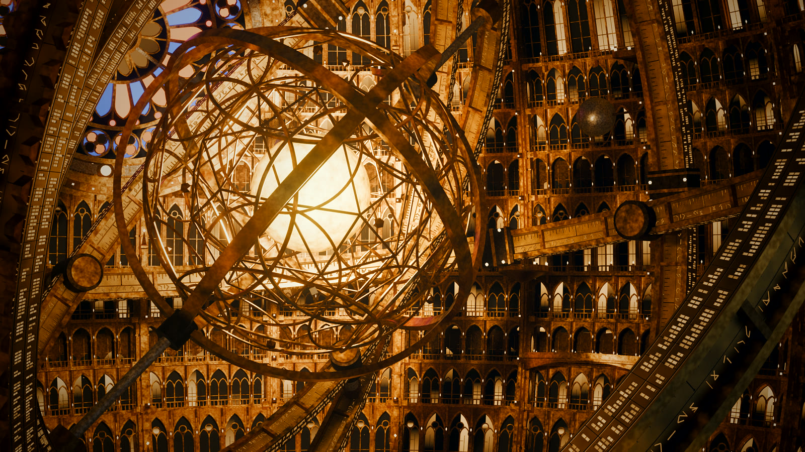

# Mechanical Moon

A 45-second film of a cracked-open moon over a night sea, with a golden clockwork megastructure inside. Everything is built procedurally with Python in Blender and rendered with EEVEE on an integrated GPU.

**Watch:** [out/mechanical_moon_phone.mp4](out/mechanical_moon_phone.mp4) (1080p, 30 fps, 24 MB)

## What is in here

- `scripts/` — the whole pipeline. No hand-modelled assets.
  - `build_crust.py`, `build_mech.py`, `build_arch.py`, `build_env.py` build the moon crust, the armillary mechanism, the gothic galleries and the sea/sky.
  - `look.py`, `mats.py` hold the shaders.
  - `shots.py`, `anim.py` define the 11 shots, camera moves and the per-shot light grade.
  - `assemble.py` puts the modules into one scene, `render.py` renders frames, `encode.ps1` grades and encodes, `mix_audio.py` builds the soundtrack.
- `out/CREDITS.txt` — music and sound effect credits.

Blend files, rendered frames, textures and the downloaded audio are not in the repo; the scripts regenerate everything except the audio.

## Setup

- Blender 4.5 LTS (EEVEE Next), run headless: `blender -b -P scripts/<script>.py`
- ffmpeg for encoding and the audio mix
- Rendered on a Ryzen 7 with a Radeon 780M iGPU, about 10–15 s per 1080p frame

Paths in the scripts point at the original project folder (`E:\fable3ddemos\3ddemo`) and need adjusting to run elsewhere.

## Credits

Music: "Passage Of Time" by Scott Buckley (CC BY 4.0). Sound effects from Freesound, mostly CC0, some CC BY. Full list in [out/CREDITS.txt](out/CREDITS.txt).

Built with Claude Code.
